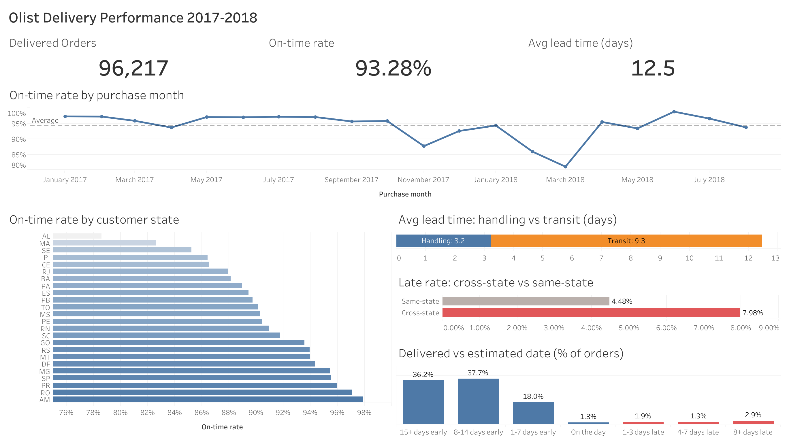

# Delivery KPI Analysis & Text-to-SQL Agent

**SQL · DuckDB · Python · Tableau · LLM**

How reliably does a Brazilian e-commerce marketplace deliver on its promised dates, and where does the time go?
I built a one-table SQL model of ~96k delivered orders, ran data-quality checks, analysed on-time rate and stage-level
lead time, and built a small text-to-SQL agent evaluated on 15 business questions.

**Headline:** 93.3% of orders arrive on or before the promised date, with an average lead time of 12.5 days.
About three-quarters of that time is spent in transit, not in seller handling. Cross-state orders are late almost twice as often as same-state orders (8.0% vs 4.5%).

## Data
[Olist Brazilian E-Commerce dataset](https://www.kaggle.com/datasets/olistbr/brazilian-ecommerce): 99,441 orders, 2016-09 to 2018-10.
Download the CSVs into `data/raw/` (they are not committed).

## How to run
```bash
python -m venv .venv && source .venv/bin/activate
pip install -r requirements.txt

python run_sql.py                      # load CSVs -> build fct_orders -> DQ checks -> KPIs (creates delivery.duckdb)
jupyter notebook notebooks/analysis.ipynb   # same pipeline with exploration + charts, exports CSVs to outputs/

cp .env.example .env                   # add ANTHROPIC_API_KEY
python agent/agent.py "What is the overall on-time rate?" --version v1 --explain
python eval/run_eval.py --check-gold   # validate gold SQL (no API calls)
python eval/run_eval.py                # v0 vs v1 accuracy -> eval/summary.md
```
DuckDB allows one writer per file, so close the notebook connection (last cell) before running scripts from a terminal.

## Repo layout
```
sql/00_load_raw.sql             raw CSV -> raw_* tables
sql/01_build_fct_orders.sql     stg_delivered_orders (with dq_issue tag) -> fct_orders
sql/02_data_quality_checks.sql  4 checks + kept/excluded summary
sql/03_kpi_analysis.sql         5 KPIs as kpi* views
notebooks/analysis.ipynb        exploration, charts, Tableau export
agent/                          text-to-SQL agent + metric definitions
eval/                           15 questions with gold SQL, scorer
outputs/                        CSVs for Tableau
```

## 1. Data model: `fct_orders`
One row per delivered order that passed the data-quality checks (**96,217 rows**).

| Column | Meaning |
|---|---|
| purchase_month | month of purchase |
| customer_state, seller_state, is_cross_state | route |
| handling_days | purchase → handed to carrier |
| transit_days | carrier → customer |
| total_lead_days | purchase → customer |
| delay_days | delivered date − estimated date (negative = early) |
| is_late | delay_days > 0 |

Design decisions:
- **Fractional days** from epoch differences. DuckDB's `date_diff('day', …)` counts midnight boundaries, so 23:00 → 01:00 would count as 1 day.
- **Lateness is compared by date**, because the estimate is a date. An order delivered on the estimated day counts as on time.
- **Multi-seller orders (2%)**: `seller_state` is the state of the seller of the first item, and `n_sellers` is kept so these orders can be filtered out.

Full definitions: [agent/metric_definitions.md](agent/metric_definitions.md).

## 2. Data quality
| Check | Rows | Handling |
|---|---|---|
| DQ1 duplicate order_id in fct_orders | 0 | Confirms the joins don't fan out |
| DQ2 timestamps out of order | 188 (165 shipped before purchase, 23 delivered before shipped) | Excluded |
| DQ3 status `delivered` but no delivery or carrier date | 9 | Excluded |
| DQ4 lead time < 0 or > 100 days | 64 | Excluded as outliers |

In total, 261 of 96,478 delivered orders (**0.27%**) are excluded. Each row is tagged in `stg_delivered_orders.dq_issue`, so every exclusion can be traced.

## 3. KPI findings
1. **Monthly on-time rate:** the rate is steady at about 96–97% through most of 2017, then drops sharply in **Nov 2017 (87.7%)** and **Feb–Mar 2018 (85.9%, 81.1%)**. Nov 2017 is the Black Friday volume spike (7.3k orders, the peak month). By June 2018 the rate recovers to 98.9%.
2. **Lead time breakdown:** the average is 12.5 days, of which **3.2 days is handling (26%)** and **9.3 days is transit (74%)**. The bigger lever is logistics, not seller processing.
3. **Worst states** (≥100 orders): AL 78.6%, MA 82.6%, SE 85.2%, PI 86.4%, CE 86.5%. All five are in the North-east, and their average transit time is 15.6–21.1 days, against 9.3 days overall.
4. **Cross-state vs same-state:** the late rate is 8.0% vs 4.5%. Average transit is 11.8 vs 4.8 days.
5. **Delay distribution:** 92% of orders arrive *early*, and 74% arrive more than a week early. The estimates are padded heavily. Only 2.9% of orders are 8 or more days late.

## 4. Dashboard (Tableau Public)
**[View the interactive dashboard on Tableau Public](https://public.tableau.com/app/profile/yin.chien.chang/viz/OlistDeliveryKPI/DeliveryDashboard)**



Built from `outputs/fct_orders.csv`. Every number matches the SQL in `sql/03_kpi_analysis.sql`.
- **KPI tiles:** delivered orders, on-time rate, average lead time
- **Monthly on-time trend:** dips in Nov 2017 and Mar 2018
- **On-time rate by customer state:** states with ≥100 orders
- **Lead time split:** handling vs transit
- **Late rate:** cross-state vs same-state
- **Delay distribution:** delivered vs estimated date

## 5. Text-to-SQL agent
Question → Claude Sonnet (Anthropic API) generates DuckDB SQL → executes it on `fct_orders` → returns the result (with `--explain`, a 1–3 sentence answer).
- **v0**: schema only (column names and types)
- **v1**: schema + [metric definitions](agent/metric_definitions.md) (business definitions, ≥100-order threshold for rankings, trend window, rounding)

**Eval:** 15 questions in [eval/questions.yaml](eval/questions.yaml): 5 simple lookups, 5 KPI calculations, 5 comparisons. Each question has gold SQL.
**Matching rule:** results are compared on values only, ignoring column names, column order and row order. Numbers must match within ±0.011 (or 0.1%), and a rate given as a fraction or as a percentage both count. Boolean group-label columns are not required.

| Version | Simple (5) | KPI (5) | Comparison (5) | Overall |
|---|---|---|---|---|
| v0 (schema only) | 5/5 | 5/5 | 3/5 | **13/15 (87%)** |
| v1 (+ metric definitions) | 5/5 | 5/5 | 5/5 | **15/15 (100%)** |

Simple lookups and single KPIs are solved from column names alone. Every v0 error is on a comparison question, where the
answer depends on a **business rule that is not visible in the schema**. Full log: [eval/summary.md](eval/summary.md).

### Typical errors
1. **No minimum sample size (c04, "3 seller states with the longest transit").** v0 ranked AM first with a 44-day average, but AM has only **3 orders**, and RO (13 orders) came second. v1 applied the ≥100-order rule and returned MA / MT / PE.
2. **Ignoring sparse months (c03, "month with the lowest on-time rate").** v0 answered **2016-09 with 0%**. That month has a single delivered order, which happened to be late. v1 limited the trend to 2017-01 to 2018-08 and found the real low point: **2018-03 (81.05%)**.
3. **What worked without definitions.** v0 handled "on-time rate", "lead time" and "how many days late on average" correctly. With descriptive column names (`is_late`, `total_lead_days`), the definitions matter less for single metrics than for *rules* (thresholds, time windows).

## Next steps
- Add seller-level handling-time analysis (which sellers drive late orders)
- Self-correction loop in the agent: retry with the error message when the SQL fails
- Grow the eval set with harder, more ambiguous questions (v1 is already at 100% on 15) and add an LLM judge for free-text answers
